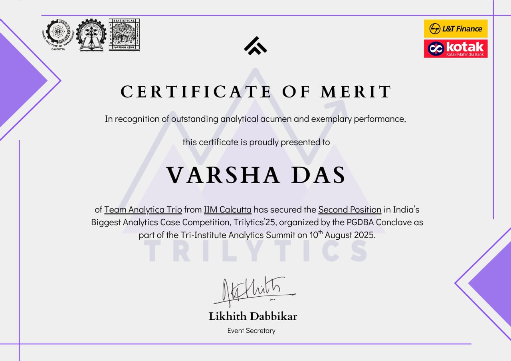

# Farmer Income Prediction: Trilytics '25 🥈 1st Runner-Up

**Trilytics '25**, a national analytics case competition organised by the PGDBA Conclave (IIM Calcutta · IIT Kharagpur · ISI Kolkata) with L&T Finance as problem partner.
**Result:** **Second position (1st runner-up)** · August 2025
**Team Analytica Trio (IIM Calcutta):** Vasubhai Mavani, Pragathi Gudaru, Varsha Das, Vikash Gupta

> **Note:** The code, dataset and predictions are not included. Under the competition terms, the data is confidential to L&T Finance and the submitted model's IP belongs to L&T Finance. Publishing them needs L&T Finance's prior approval. This repository describes the approach and the result only.

## Problem
Farmers often have thin or no credit history, so lenders struggle to judge whether they can repay. The task was to **predict farmer income** from demographic, land-holding, climate and village-level living-standard data, to support credit assessment for the unbanked. Submissions were ranked by **MAPE** on unseen data.

## Approach
1. **Exploratory analysis:** income is heavily right-skewed. Land under agriculture, non-farm income, electricity and sanitation access, and region all relate to it.
2. **Preprocessing:** parsing of climate and irrigation fields, encoding, outlier treatment, and VIF checks for multicollinearity.
3. **Modelling strategies compared:**
   - A baseline on the cleaned data, and a model trained after removing outliers
   - Class-based models: separate regressors for low, medium and high income groups
   - A split-income model: predict agricultural income, then add non-agricultural income back
4. **Models:** OLS → Random Forest → XGBoost → LightGBM, with a log-transformed target and Optuna tuning
5. **Explainability:** split-based and SHAP feature importance, compared to tell features that only separate groups from those that actually move predictions

## Results (MAPE, lower is better)
| Model | MAPE |
|---|---:|
| OLS regression | 36.11 % |
| Random Forest | 32.95 % |
| XGBoost | 28.68 % |
| XGBoost + log target | 24.47 % |
| LightGBM + log target | 23.17 % |
| **LightGBM + Optuna (after outlier removal)** | **20.84 %** |

**Top income drivers (SHAP):** total land for agriculture, non-agricultural income, state and region (Karnataka, West), agro-climatic zone, sanitation and electricity access.

## Certificate

## Tech
Python · LightGBM · XGBoost · Optuna · SHAP · scikit-learn · statsmodels · pandas
